<p align="center">
  
</p>

<p align="center">
  <a href="https://www.linkedin.com/in/daniel-silveira-303849394"></a>
  <a href="mailto:danielcmottas@gmail.com"></a>
  
</p>

### `$ cat about.md`

Computer Science student at **CIn-UFPE** (GPA 9.52) and **Data Analyst at CITi**, CIn's junior enterprise. I build data & AI solutions end to end — SQL, dashboards, RAG and multi-agent LLM systems on WhatsApp — for real companies in health, energy, real estate and tech.

### `$ ps aux --sort=impact`

```text
PID  PROJECT                                STACK                        STATE
101  ERP dashboard · health distributor     SQL Server · Next.js         shipped · 10+ users
102  Fleet routing/tracking + driver app    ERP · Maps · WhatsApp API    running
103  Real-estate platform + multi-agent AI  Supabase · LLM orchestrator  @ CITi
104  Data-viz for a tech & AI partner       PostgreSQL · APIs · Next.js  @ CITi
105  Data security audit · energy co.       SQL Server · VM · VPN        @ CITi
106  RAG & LLM data project                 LangChain · LangGraph · n8n  @ CITi
```

### `$ ls ~/stack`

<p>
  <br />
  
</p>

`LangChain` `LangGraph` `n8n` `RAG` `Pandas` `NumPy` `Matplotlib` `SQL Server` `Power BI` `Looker Studio` `Railway` `Claude Code`

### `$ cat achievements.log`

```diff
+ GPA 9.52 / 10 — Computer Science @ CIn-UFPE
+ 13 olympiad medals in math, physics & astronomy — incl. gold at Kangaroo Math (intl.) and Math Without Borders
+ Admitted to CS @ USP (Fuvest) · 2nd place at CESAR School's entrance exam, twice
+ Teaching assistant · Intro to Programming, 2 semesters
```

<picture>
  <source media="(prefers-color-scheme: dark)" srcset="https://raw.githubusercontent.com/DanM0tt/DanM0tt/output/github-snake-dark.svg" />
  <source media="(prefers-color-scheme: light)" srcset="https://raw.githubusercontent.com/DanM0tt/DanM0tt/output/github-snake.svg" />
  
</picture>
